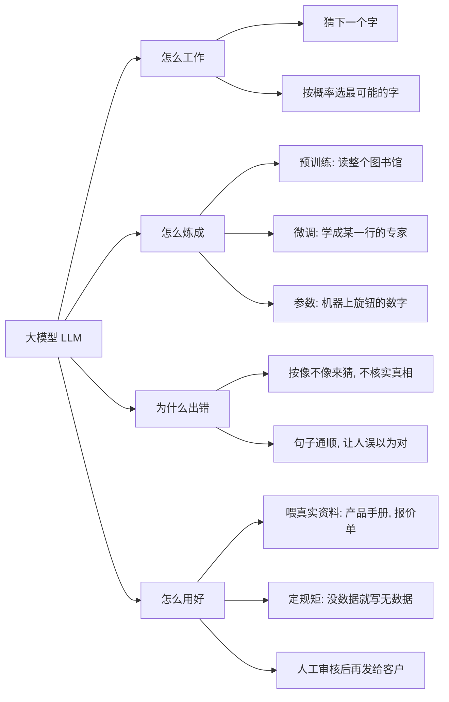

# 第 1 周：大模型全景（2026-10-26）

## 今天学了：AI 是如何运行的

来源：Karpathy《Intro to Large Language Models》前 25 分钟

1. **靠猜下一个字来回答。** 比如问“今天的天气？”，它回答“好”，是一个字一个字往外蹦出来的。
2. **背后是一个很大的文件（模型参数）。** 这个文件是花费很多钱、很多人力，用海量收集来的资料训练出来的。
3. **为什么有时会出错（幻觉）。** 它并不是上网查询再验证，而是按照之前训练出来的规律“猜”出来的；猜得像，不等于是真的。

## 纠正

- 一开始我以为“AI 是上网查询，不会验证”，这是错的：模型本身是按训练学到的规律猜出来的，上网搜索只是后来额外加的工具。

## 对外贸的启发

- 用 AI 写报价、查产品参数、查客户资料时，一定要人工核对，不能直接相信。

## 追问 5 轮（2026-10-26）

1. **它怎么知道哪个字概率高？** 比如“今天太阳很大，天气很__”，可能接“好”“热”“冷”等字，但“太阳大”后面最常对应的是“热”。补充：它不是临时去数哪个字出现最多，而是训练时已经把这种规律压进参数里，回答时直接算出概率。
2. **什么是参数？** 参数就像一台超级机器上每个旋钮上的数字。训练就是一遍遍调这些旋钮，直到它猜得准。
3. **预训练和微调的区别？** 预训练是把 AI 放进一个超级大的图书馆里大量学习；之后再微调，告诉它更专业、更细的知识，让它成为这一行的专家。
4. **为什么会幻觉，怎么减少？** AI 会让句子读起来很通顺，让人误以为是对的，但它其实是靠猜在“胡说”。减少幻觉：针对性微调让它学专业知识；更常用的是把真实资料（产品手册、报价单）喂给它，让它照着资料回答；最后再加人工审核。
5. **用 AI 写外贸报价邮件，哪里容易出错？** 和第 4 条的办法一样。再加一条规矩：要让 AI 区分“知道”和“不知道”，不要瞎说——有数据就输出数据，没有数据就写“无数据”。（这叫“约束输出”。）

### 可以直接用的提示词

> 只根据我提供的资料回答。资料里没有的信息（比如价格、交期、起订量、认证），一律写“无数据”，不要猜，也不要编。

## 一页纸总结

**大模型就是读了海量文字、靠参数记住规律、一个字一个字“猜”答案的机器。猜得通顺不等于说得对，所以要喂它真实资料、给它定规矩，再加上人工审核。**

“怎么用好”这一支，就是以后做外贸 AI 客服和报价的底子。

## 10.27 Token 与上下文窗口

### 动手实验：OpenAI Tokenizer
| 句子 | Token 数 |
|---|---|
| `Hello, how are you?` | 6 |
| `你好，最近怎么样？` | 5 |
| `We offer FOB price USD 2.5/pc, MOQ 1000pcs.` | 18 |

发现：外贸报价句子不长，token 却最多，因为 FOB、USD、2.5、/pc、MOQ、1000pcs 这类缩写和数字会被拆成很多碎块。报价单、产品参数特别费 token。

### 我的理解（手写笔记整理）
1. **Token** 是 AI 读文字的最小单位，也是计算用量和收费的单位。英文一般一个单词或三四个字母算 1 个 token，中文一两个字算 1 个 token。
2. **上下文** 是 AI 这次能看到的全部内容：规则 + 聊天记录 + 贴进去的资料等。它有容量上限，叫**上下文窗口**。超过上限，最早的内容会被挤出去，所以 AI 不是忘了，是看不到了。
3. **50 页产品目录的问题**：可能塞不下；塞下了也可能抓不住重点，把价格、MOQ 弄混，看起来没问题但数据是错的。所以要：把资料切成小块，只喂跟问题相关的部分（RAG）；要求没有数据就写"无数据"；关键数字人工核对。

### 视频 25–45 分钟核心（Karpathy）
1. 大模型其实就两个文件：存参数的大文件 + 运行它的小程序。
2. 它把海量文字压缩进参数里，像一份"有损压缩的互联网"，记住的是大概，不是原文。
3. 所以它会一本正经地"做梦"，也就是幻觉。
