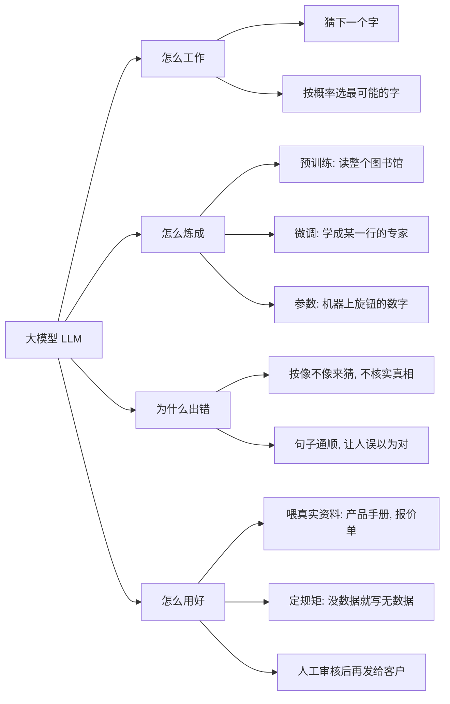

# 第 1 周：大模型全景（2026-10-26）

## 今天学了：AI 是如何运行的

来源：Karpathy《Intro to Large Language Models》前 25 分钟

1. **靠猜下一个字来回答。** 比如问“今天的天气？”，它回答“好”，是一个字一个字往外蹦出来的。
2. **背后是一个很大的文件（模型参数）。** 这个文件是花费很多钱、很多人力，用海量收集来的资料训练出来的。
3. **为什么有时会出错（幻觉）。** 它并不是上网查询再验证，而是按照之前训练出来的规律“猜”出来的；猜得像，不等于是真的。

## 纠正

- 一开始我以为“AI 是上网查询，不会验证”，这是错的：模型本身是按训练学到的规律猜出来的，上网搜索只是后来额外加的工具。

## 对外贸的启发

- 用 AI 写报价、查产品参数、查客户资料时，一定要人工核对，不能直接相信。

## 追问 5 轮（2026-10-26）

1. **它怎么知道哪个字概率高？** 比如“今天太阳很大，天气很__”，可能接“好”“热”“冷”等字，但“太阳大”后面最常对应的是“热”。补充：它不是临时去数哪个字出现最多，而是训练时已经把这种规律压进参数里，回答时直接算出概率。
2. **什么是参数？** 参数就像一台超级机器上每个旋钮上的数字。训练就是一遍遍调这些旋钮，直到它猜得准。
3. **预训练和微调的区别？** 预训练是把 AI 放进一个超级大的图书馆里大量学习；之后再微调，告诉它更专业、更细的知识，让它成为这一行的专家。
4. **为什么会幻觉，怎么减少？** AI 会让句子读起来很通顺，让人误以为是对的，但它其实是靠猜在“胡说”。减少幻觉：针对性微调让它学专业知识；更常用的是把真实资料（产品手册、报价单）喂给它，让它照着资料回答；最后再加人工审核。
5. **用 AI 写外贸报价邮件，哪里容易出错？** 和第 4 条的办法一样。再加一条规矩：要让 AI 区分“知道”和“不知道”，不要瞎说——有数据就输出数据，没有数据就写“无数据”。（这叫“约束输出”。）

### 可以直接用的提示词

> 只根据我提供的资料回答。资料里没有的信息（比如价格、交期、起订量、认证），一律写“无数据”，不要猜，也不要编。

## 一页纸总结

**大模型就是读了海量文字、靠参数记住规律、一个字一个字“猜”答案的机器。猜得通顺不等于说得对，所以要喂它真实资料、给它定规矩，再加上人工审核。**



“怎么用好”这一支，就是以后做外贸 AI 客服和报价的底子。

## 10.27 Token 与上下文窗口

### 动手实验：OpenAI Tokenizer
| 句子 | Token 数 |
|---|---|
| `Hello, how are you?` | 6 |
| `你好，最近怎么样？` | 5 |
| `We offer FOB price USD 2.5/pc, MOQ 1000pcs.` | 18 |

发现：外贸报价句子不长，token 却最多，因为 FOB、USD、2.5、/pc、MOQ、1000pcs 这类缩写和数字会被拆成很多碎块。报价单、产品参数特别费 token。

### 我的理解（手写笔记整理）
1. **Token** 是 AI 读文字的最小单位，也是计算用量和收费的单位。英文一般一个单词或三四个字母算 1 个 token，中文一两个字算 1 个 token。
2. **上下文** 是 AI 这次能看到的全部内容：规则 + 聊天记录 + 贴进去的资料等。它有容量上限，叫**上下文窗口**。超过上限，最早的内容会被挤出去，所以 AI 不是忘了，是看不到了。
3. **50 页产品目录的问题**：可能塞不下；塞下了也可能抓不住重点，把价格、MOQ 弄混，看起来没问题但数据是错的。所以要：把资料切成小块，只喂跟问题相关的部分（RAG）；要求没有数据就写"无数据"；关键数字人工核对。

### 视频 25–45 分钟核心（Karpathy）
1. 大模型其实就两个文件：存参数的大文件 + 运行它的小程序。
2. 它把海量文字压缩进参数里，像一份"有损压缩的互联网"，记住的是大概，不是原文。
3. 所以它会一本正经地"做梦"，也就是幻觉。

## 10.27 实战练习：用 AI 回复英文询盘

> 以下询盘和产品资料都是**练习用的模拟数据**，不是真实报价。

**模拟询盘**：德国宠物连锁店 Anna，询 2000 个 M 码不锈钢宠物碗的价格、交期，以及是否有 LFGB 认证。

**练习资料**：304 不锈钢、直径 18cm、防滑橡胶底；FOB 宁波 USD 1.80/个；MOQ 1000；交期定金后 25 天；T/T 30/70；有 FDA，没有 LFGB 信息。公司名：快宇。

### 结果
- ✅ **最关键的一关过了**：LFGB 那里 AI 没有乱编，写了“尚无确认信息”，还反问客户是否必须。这就是“没有数据就输出无数据”的作用。
- ✅ 总价算对了：2000 × 1.80 = 3600 美元（定金 1080，尾款 2520）。

### 我的提示词做对的
角色（20 年外贸经理）+ 全部资料 + 规则。

### 下次改进
1. 规则写成命令（“只用以下资料，没有的写无数据，不得编造”），不要让 AI 去猜。
2. 说清楚要什么格式（“只输出英文邮件和中文翻译”），省 token、省时间。
3. 发出前人工核对数字和认证。

### 收获
整理出一个可反复使用的提示词模板：[外贸询盘智能回复助手](templates/inquiry-reply-prompt.md)。

### 三版迭代过程
| 版本 | 我改了什么 | 结果 | 问题 |
|---|---|---|---|
| 第 1 版 | 角色 + 资料 + 五点角度 | 没编 LFGB，总价算对 | 输出太长（五大块） |
| 第 2 版 | 加“只用以上资料，无资料反馈无资料，只输出邮件和翻译” | 短了一大半，一个没编 | 邮件里出现很多 "Information not available"，客户看了不专业 |
| 第 3 版 | 缺失信息不写进邮件，单列待确认清单；客户问了没数据的写“正在确认” | 可以直接发 | 只剩落款和主题行要人工补 |

### 今天最值钱的一课
**“无数据”是写给自己看的，不是写给客户看的。**
- 对内：缺什么列成清单，去补齐或找工厂确认。
- 对外：客户没问的不写；问了但没数据的，写“正在核实，确认后回复”。
- 提示词优化流程：写出来 → 看哪里不对 → 改规则 → 再跑一次。
- AI 出初稿，人做最后把关：落款换成公司正式英文名 + 业务员名字 + 联系方式，并加主题行。

### 最终版邮件（练习数据）
```
Subject: Quotation for Stainless Steel Pet Bowls – 2,000 pcs

Dear Anna,

Thank you for your inquiry and your interest in our stainless steel pet bowls.

We are pleased to offer you the following quotation for your requested quantity of 2,000 pieces.

Product Specifications
- Product: Stainless Steel Pet Bowl
- Size: M (18 cm diameter)
- Material: 304 Stainless Steel
- Feature: Non-slip rubber base

Quotation & Trade Terms
- Quantity: 2,000 pcs
- Unit Price: USD 1.80/pc
- Total Amount: USD 3,600.00
- Trade Term: FOB Ningbo
- MOQ: 1,000 pcs
- Lead Time: 25 days after receipt of deposit
- Payment Terms: T/T 30% deposit, 70% balance before shipment

Certification
We have FDA certification.
Regarding your question about LFGB certification, we are currently checking the relevant information and will get back to you once it is confirmed.

Thank you again for your interest. We look forward to your feedback and the opportunity to cooperate with you.

Best regards,
[业务员姓名]
Sales Team, [公司正式英文名]
[邮箱 / 电话]
```

### 待确认清单（内部使用）
| 项目 | 状态 | 建议 |
|---|---|---|
| LFGB 认证 | 无数据 | **优先**确认是否有 LFGB 测试报告或证明文件 |
| 产品颜色 | 无数据 | 确认可提供的颜色 |
| 包装方式 | 无数据 | 确认单个包装、外箱规格 |
| 联系人姓名 | 无数据 | 补充业务员姓名 |
| 公司英文名 | 无数据 | 确认正式英文名称 |
| 公司优势 | 无数据 | 确认是否工厂直供等 |
| 报价有效期 | 无数据 | 确认价格有效截止日期 |
| FDA 文件详情 | 有信息，未提供文件 | 核实文件类型、适用产品和有效性 |

## 10.28 AI 分支关系图

**一句话记住：** 大模型是深度学习的一种，深度学习是机器学习的一种，机器学习是人工智能的一种。是一层套一层，不是并列。

```mermaid
graph TD
A[人工智能 AI：让机器表现得聪明] --> B[机器学习 ML：给机器看很多例子，让它自己学会规律]
B --> C[深度学习 DL：多层神经网络，层数多所以叫"深"]
C --> D[大模型 LLM：海量文字训练、参数巨大，如 ChatGPT、Codex]
```

**类比：** 就像地址 中国 ⊃ 浙江 ⊃ 宁波 ⊃ 鄞州区，大的包着小的。

**我的手绘过程：**
- 第一版凭猜测画，方向反了：把人工智能画在最里面，还把"回邮件、回信息""AI 制作"这类用途也画成了圈。
- 纠正：人工智能应该在最外圈；用途不是一个圈，可以写在圈外当备注。
- 第二版正确：从外到内是 人工智能 → 机器学习 → 深度学习 → 大模型。

**追问与解答：**
- ChatGPT 是"最深"的深度学习吗？不是。"深度"指神经网络层数多，不代表更高级。ChatGPT 是一个用深度学习训练出来的大模型。
- 那 Codex 呢？Codex 和 ChatGPT 是同一家公司（OpenAI）的两个产品，背后都是大模型，用途不同：ChatGPT 用来聊天、写邮件、回询盘；Codex 用来写代码。两个都在最里面"大模型"那一圈。
- 生成式 AI：按"能不能生成新内容（文字、图片、视频）"另外划分的一类，和大模型有很大重叠，第一周先不深究。

## 10.28 待学清单（ChatGPT 扮演小白追问 5 轮）

**练习方法：** 让 ChatGPT 扮演完全不懂 AI 的小白，连续追问 5 轮，我来回答，找出自己答不上或答不准的点。

**ChatGPT 的点评要点（第 5 题）：**
| 问题 | 我的回答 | 需要补充的地方 |
|---|---|---|
| Token 是什么 | 对应单词或字，会计算消耗成本 | Token 也可能是词的一部分、标点或空格；它不只影响成本，还决定 AI 一次能处理多少信息 |
| 上下文窗口是什么 | 不是忘了，是上下文太长看不见了 | 说得很好。补充：信息即使还在窗口里，内容太长太复杂时 AI 也可能提取错误 |
| 如何处理 300 种产品 | 分批、有规则地让 AI 吸收 | 误区：AI 读过资料不等于记住，新会话它就不知道了。应该建产品数据库，AI 回答前先检索（RAG），精确数据（型号、价格、MOQ）还要配合数据库查询和程序校验 |

> 注：ChatGPT 给的 33.5/50 分是它自己的教学估分，它也说明了不是标准化测试，仅供参考。

**我的待学清单（薄弱点）：** 参数、微调、RAG、数据库之间的区别。

**一句话分清：**
- **参数**：AI 脑子里固有的知识，训练时定下来的，我改不了。
- **微调**：再训练一次，改变它的说话习惯；成本高，外贸场景一般用不上。
- **数据库**：我自己的产品表格（型号、价格、MOQ、资料出处）。
- **RAG（检索增强生成）**：让 AI 回答前先查我的数据库，再照着数据回答；查不到就写"无数据"，不编造。

**300 种产品的正确做法：** 50 页目录 → 提取整理产品资料 → 建可检索的产品数据库 → 按询盘检索匹配产品 → AI 根据查到的资料生成回复 → 缺失数据不编造，关键条款人工核实。

**下一阶段预告：** ChatGPT 建议换成"外贸老板出业务需求、我来设计 AI 方案"的练法（例如 10 个销售每天 200 封询盘怎么用 AI 处理），放到第 4 周询盘回复助手时再练。

## 10.28 RAG 实战练习：有没有产品表，差别有多大

> ⚠️ 以下产品数据是练习用的示例数据，不是真实报价。

**练习方法：** 同一个问题问两次 ChatGPT，一次不给资料，一次给一张"迷你产品库"，对比回答。

**示例产品表：**
| 型号 | 产品 | 规格 | FOB宁波单价 | MOQ | 交期 |
|---|---|---|---|---|---|
| A100 | 不锈钢宠物碗 | 18cm, 304不锈钢 | USD 1.80 | 1000 | 25天 |
| B200 | 陶瓷宠物碗 | 15cm, 可进洗碗机 | USD 2.60 | 500 | 30天 |
| C300 | 硅胶折叠碗 | 13cm, 食品级硅胶 | USD 0.95 | 2000 | 20天 |

**第一次（不给资料）：** 问"快宇公司的 B200 陶瓷宠物碗多少钱？MOQ 是多少？"。ChatGPT 搜了网页没找到，回答单价和 MOQ "待确认"，并建议上传报价表。

**第二次（给产品表 + 规则"表里没有写无数据，不要编造"）：**
| 问题 | AI 回答 |
|---|---|
| B200 多少钱？MOQ？ | FOB宁波 USD 2.60/个，MOQ 500 个 |
| 客户要 800 个 C300 可以吗？ | 不满足 MOQ（2000），需与公司确认是否接受 |
| 有没有木质宠物碗？ | 无数据，产品表中没有 |
| A100 有 LFGB 认证吗？ | 无数据，产品表未提供认证信息 |

**我的结论：** 没有产品表，AI 输出的内容就没有依据。以后做外贸，这一点很重要，不要让 AI 乱讲。

**补充要点：**
1. 第一次 ChatGPT 没编价格，是因为它去搜了、没搜到。换个问法或换个 AI，它很可能随口编一个看起来很真的价格。所以不能靠运气，要靠规则和资料。
2. 第 2 题答得好：AI 只摆事实（低于 MOQ），是否接受由人来决定。

**一句话记住 RAG：** AI 回答的质量取决于你给它的资料。没有资料，它只能猜。刚才粘贴的产品表就是"数据库"，"先查表再回答"就是 RAG；真正的系统只是让程序自动去查表。

